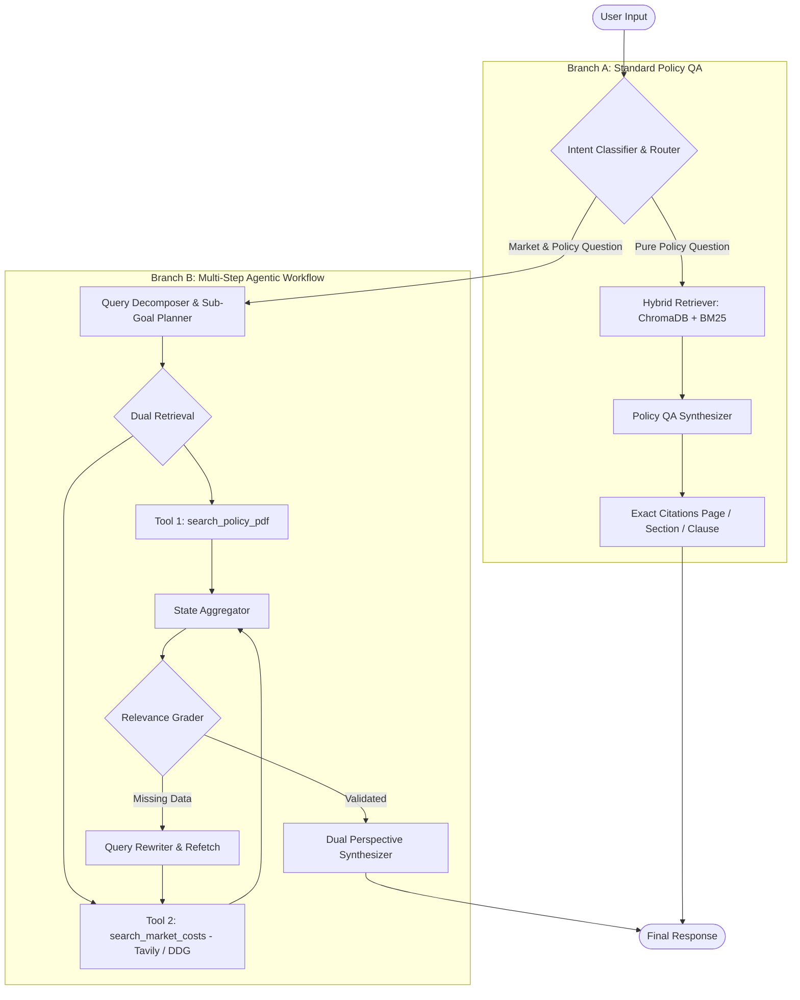

# HDFC ERGO Policy Assistant & Agentic RAG System
> **Digiqt Technolabs Practical Task Submission — AI Engineer**

An enterprise-grade, dual-mode health insurance AI system combining **Strict Policy-Grounded RAG** (with exact Page, Section, and Clause citations) and **Multi-Step Agentic RAG** (using LangGraph for market healthcare research & local procedure cost analysis).

---

## 🌟 Key Capabilities

### 1. Standard Policy RAG (Deterministic Policy QA)
- **Zero Hallucinations**: Grounded strictly in the official 53-page **HDFC ERGO Optima Secure Policy Wording** (`optima-secure-revision-pw.pdf`).
- **Precision Citations**: Every response cites the exact **Page Number**, **Section**, and **Clause Name/Code** (e.g. `Page: 28, Section: SECTION C. WAITING PERIOD AND EXCLUSIONS, Clause: Specified Disease/Procedure waiting period: Code – Excl02`).
- **Hybrid Retrieval**: Combines dense semantic search (ChromaDB) and sparse keyword matching (BM25) via **Reciprocal Rank Fusion (RRF)** to eliminate missed clause references.
- **Strict Guardrails**: Refuses assumptions, handles exceptions and conditions, and explicitly prompts when additional customer information is required.

### 2. Multi-Step Agentic RAG (LangGraph State Machine)
- **Autonomous Intent Routing**: Classifies queries between policy-only questions and queries requiring external market intelligence.
- **Decomposition**: Splits composite questions into internal policy verification sub-goals and external healthcare market sub-goals.
- **Market Retrieval**: Integrates **Tavily AI Search** with automatic fallback to **DuckDuckGo** and curated regional healthcare data for Indian cities (Ahmedabad).
- **Self-Correction & Relevance Grading**: Evaluates web snippets for surgical modalities (RIRS, PCNL, URSL, ESWL) and local INR (₹) price ranges before answering.
- **Dual Synthesis**: Synthesizes a structured response presenting Market Medical Options & Local Ahmedabad Costs alongside Policy Coverage & Admissibility.

---

## 🏗️ Architecture



---

## 🎯 Benchmark Question Verification Matrix

| # | Question from Digiqt Assignment PDF | Expected Outcome | Policy Citation |
|---|---|---|---|
| **1** | *What is the waiting period for pre-existing diseases?* | **36 months** of continuous coverage. Can be optionally reduced to 24 or 12 months at inception. | **Page: 28**, Section C.1.a (Code – Excl01); Optional: **Page 25**, Section B.2.12 |
| **2** | *Is day care treatment covered under this policy?* | **Covered up to Sum Insured**. The 24-hour hospitalization minimum does not apply to day care. | **Page: 11**, Section B.1.1.1 (iv) & Note (i); **Page 4**, Def. 11 |
| **3** | *If I am hospitalized and my daily room rent is around ₹15,000, will it be covered?* | **Covered "At Actuals"** (no cap) under standard Optima Secure. Capped at Single Private Room under Optima Select; 1% under Optima Lite. | **Page: 11**, Section B.1.1.a; **Page 50**, Annexure C |
| **4** | *I purchased the policy 5 months ago. Will my kidney stone surgery be covered?* | **Not Covered**. Kidney stone (calculus of urogenital system) has a mandatory **24-month** waiting period. | **Page: 28–29**, Section C.1.b (Code – Excl02) |
| **5** | *I already had gallbladder stones when I purchased the policy 130 days ago. Now I need surgery. Will this treatment be covered?* | **Not Covered**. Pre-existing conditions require **36 months** (or the longer period under C.1.b.iii). 130 days is far below the requirement. | **Page: 28**, Section C.1.a (Code – Excl01) & **Page 29**, Section C.1.b.iii |
| **6** | *What documents are required for a claim?* | Lists all 20 required documents: completed claim form, photo ID, discharge card, final hospital bill, diagnostic reports, implant invoices, etc. | **Page: 43–44**, Section E.1.7 (items a–t) |
| **7** | **Agentic Scenario**: *Kidney stone surgery options & costs in Ahmedabad?* | Breaks down **RIRS**, **PCNL**, **URSL**, **ESWL** with Ahmedabad price ranges (₹30k–₹1.45L) + HDFC ERGO 24-month waiting period analysis and day-care terms. | **Page 28–29**, Section C.1.b (Excl02) + **Page 11**, Section B.1.1.1.iv + Web Sources |
| **8** | *Accident 15 days after buying policy: Is surgery covered despite the 30-day waiting period?* | **Covered Immediately**. Section C.1.c.i & Section C.1.b.i explicitly state waiting periods do NOT apply to accidental injuries. | **Page: 28 & 30**, Clause C.1.b.i & Clause C.1.c.i |
| **9** | *Discharged in 6 hours for cataract/day-care: Will it be denied due to the 24-hour hospitalization rule?* | **Covered as Day Care**. Section B-1.1 Note i explicitly waives the 24-consecutive-hour minimum stay for Day Care procedures. | **Page: 11**, Clause B.1.1 Note i & Clause B.1.1.1.iv |
| **10** | *Cashless request denied by insurer: Is the claim permanently rejected?* | **No**. Denial of cashless access is not a claim repudiation; the insured may file for Reimbursement under Section E.1.2.g. | **Page: 42**, Clause E.1.2.g |
| **11** | *Held policy for 5 continuous years: Can insurer contest claim for pre-existing non-disclosure?* | **No**. Section D.1.6 establishes a **Moratorium Period of 60 continuous months**, after which claims cannot be disputed (except proven fraud). | **Page: 34**, Clause D.1.6: Moratorium Period |
| **12** | *Multi-City Agentic: Heart Bypass Surgery in Mumbai?* | Dual-mode synthesis: Mumbai cardiac costs (₹1.5L–₹5L across Narayana/Hinduja/Asian Heart) + Section B.1.1 inpatient benefits, waiting periods, and pre-auth rules. | **Page 11 & 28**, Section B.1.1 & Section C + Web Sources |
| **13** | *Multi-City Agentic: Total Knee Replacement in Delhi?* | Dual-mode synthesis: Delhi orthopedic costs (₹2L–₹4.5L) + Section C.1.b 24-month Specified Disease waiting period for joint replacement (Code Excl02 item vi). | **Page 28–29**, Section C.1.b (Code Excl02 item vi) + Web Sources |

---

## 🚀 Quickstart Guide

### 1. Prerequisites
- Python 3.11+
- Virtual environment (recommended)

### 2. Installation
```bash
# Clone the repository
git clone https://github.com/your-username/DigiQT.git
cd DigiQT

# Install dependencies
pip install -r requirements.txt
```

### 3. Configure Environment Variables
Copy `.env.example` to `.env`:
```bash
cp .env.example .env
```
Edit `.env` with your API keys:
```ini
# NVIDIA NIM API Configuration
NVIDIA_API_KEY=nvapi-your_actual_key_here
NVIDIA_BASE_URL=https://integrate.api.nvidia.com/v1
NVIDIA_MODEL_NAME=meta/llama-3.3-70b-instruct

# Optional: Tavily Search API (Falls back to DuckDuckGo if left blank)
TAVILY_API_KEY=your_tavily_api_key_here
```

### 4. Run the Streamlit Application
```bash
streamlit run src/ui/app.py
```
Open your browser at `http://localhost:8501`.

### 5. Run Automated Tests
```bash
pytest tests/ -v
```

---

## 📂 Project Structure

```text
DigiQT/
├── README.md                          # Documentation & benchmark analysis
├── plan.md                            # Comprehensive architectural plan
├── requirements.txt                   # Production dependencies
├── .env.example                       # API key template
├── data/
│   ├── optima-secure-revision-pw.pdf  # Downloaded source policy document
│   └── chroma_db/                     # Persistent Chroma vector database
├── src/
│   ├── __init__.py
│   ├── config.py                      # NVIDIA LLM & system configuration
│   ├── ingestion/
│   │   ├── __init__.py
│   │   ├── parser.py                  # Page & clause-aware PDF parser
│   │   └── indexer.py                 # Hybrid retriever (ChromaDB + BM25)
│   ├── tools/
│   │   ├── __init__.py
│   │   ├── policy_retriever.py        # Policy retrieval with metadata citations
│   │   └── web_search.py              # Tavily & DuckDuckGo adapter
│   ├── graph/
│   │   ├── __init__.py
│   │   ├── state.py                   # LangGraph TypedDict state
│   │   ├── nodes.py                   # Graph nodes (Router, Grader, Synthesizer)
│   │   └── workflow.py                # StateGraph compilation & execution
│   └── ui/
│       └── app.py                     # Streamlit web app with trace viewer
└── tests/
    ├── test_policy_rag.py             # Unit tests for policy questions
    └── test_agentic_workflow.py       # Integration tests for agentic RAG
```

---

## 🛠️ Technology Stack
- **Agent Framework**: [LangGraph](https://github.com/langchain-ai/langgraph)
- **LLM Engine**: NVIDIA NIM (`meta/llama-3.3-70b-instruct`, `mistralai/mistral-large-2-instruct`, `deepseek-ai/deepseek-r1`)
- **Vector Database**: [ChromaDB](https://www.trychroma.com/) (Local persistent)
- **Sparse Retrieval**: BM25 (`rank-bm25`)
- **Search Tooling**: [Tavily AI](https://tavily.com/) + DuckDuckGo (`ddgs`)
- **Frontend**: [Streamlit](https://streamlit.io/)

