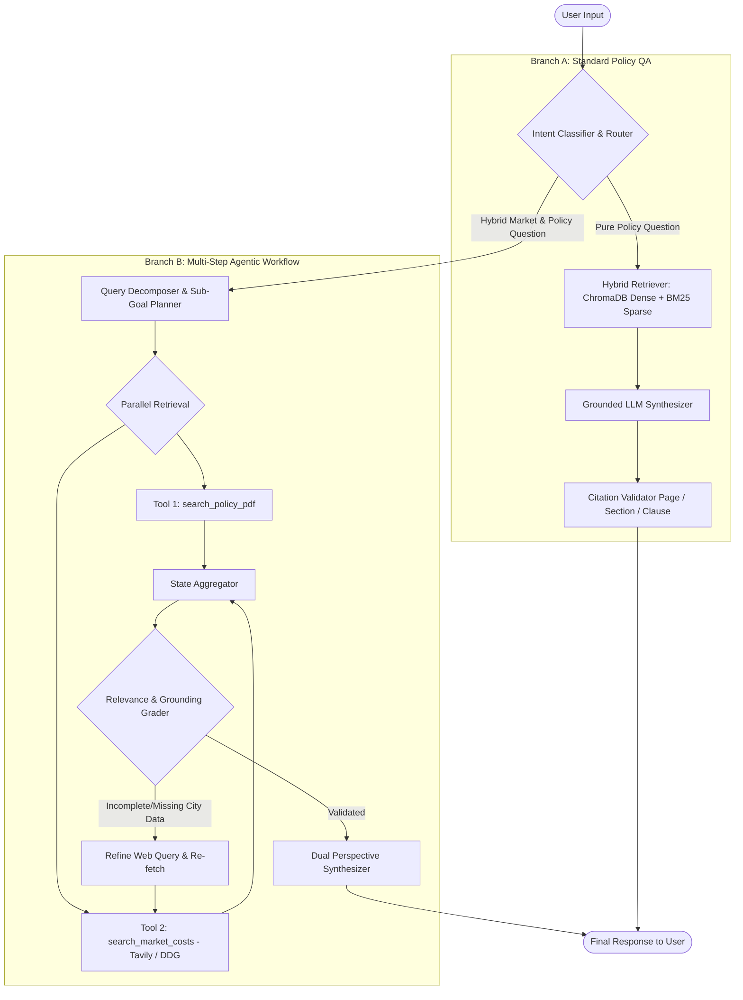

# Health Insurance Policy Assistant & Agentic RAG System
## Project Implementation Plan

---

### 1. Executive Summary & Objective

This project implements an intelligent, multi-step health insurance AI assistant for **Digiqt Technolabs**. The system satisfies two distinct modes of operation:

1. **Standard Policy RAG (Deterministic & Grounded)**:
   - Evaluates user questions against the official **Comprehensive Health Insurance Policy Wording** (53-page document).
   - Strict adherence to ground truth with zero assumptions.
   - Enforces standardized citations specifying **Page Number**, **Section**, and **Clause Name/Code**.
   - Handles policy conditions, exceptions, waiting periods, and notices when additional user information is needed.

2. **Agentic RAG (Multi-Step Research & Cost Synthesis)**:
   - Triggered when questions require external market and healthcare data outside the static policy document.
   - Addresses composite scenarios such as:
     > *"If I need kidney stone surgery, how much will it cost, what treatment options are available in the market, and how much does each option typically cost? Tell me for Ahmedabad?"*
   - Coordinates dual parallel retrieval (Policy Rules + Web Market Intelligence), evaluates source quality with self-correction, and synthesizes a dual-perspective report (Medical Market Costs vs. Insurance Policy Admissibility).

---

### 2. Architecture & Data Flow



---

### 3. Recommended Technology Stack

| Layer | Recommended Choice | Alternatives Considered | Rationale |
| :--- | :--- | :--- | :--- |
| **Agent Orchestration** | **LangGraph** (`langgraph`) | CrewAI, LlamaIndex Workflows, Swarm | Provides deterministic state-machine control, cyclic recovery edges, inspectable agent steps, and enterprise-grade reliability. |
| **LLM Engine** | **NVIDIA NIM LLMs** (e.g. `meta/llama-3.3-70b-instruct`, `deepseek-ai/deepseek-r1`, `mistralai/mixtral-8x22b-instruct` via OpenAI-compatible endpoint or `langchain-nvidia-ai-endpoints`) | Gemini, OpenAI | High-parameter open weights hosted on NVIDIA NIM; extremely accurate reasoning and extraction for complex insurance documents. Configurable via `.env` (`NVIDIA_API_KEY`). |
| **Vector DB** | **ChromaDB** (`chromadb`) | FAISS, Qdrant | Fast, embedded SQLite-backed vector storage with zero external infrastructure required. |
| **Sparse Retrieval** | **BM25** (`rank_bm25`) | Whoosh | Crucial for exact insurance codes (`Excl01`, `Excl02`, `130 days`, `calculus`). |
| **Ensemble Retriever** | **LangChain EnsembleRetriever** | Custom RRF | Implements Reciprocal Rank Fusion combining Dense (semantic) + BM25 (keyword). |
| **Web Search API** | **Tavily AI** (`tavily-python`) with **DuckDuckGo** (`duckduckgo-search`) fallback | Google Custom Search, Serper, Exa | Tavily provides LLM-ready markdown chunks; DDGS ensures 100% free offline execution if no API key is provided. |
| **PDF Extraction** | **pypdf** & **pdfplumber** | PyPDF2, Unstructured | Accurately extracts page-by-page text, table structures (Annexure C), and headers. |
| **UI & Visualization** | **Streamlit** | Chainlit, Gradio | Interactive chat UI with live agent thought process expander, policy reference preview, and quick-prompt chips. |

---

### 4. Precision Document Parsing & Ground Truth Mapping

To satisfy the strict citation requirement (`Page`, `Section`, `Clause`), chunks must retain hierarchical metadata:

#### Document Section Map (Comprehensive Health Insurance Policy)
- **Pages 2–10**: Section A – Standard & Specific Definitions (e.g., Def 10: Day Care Centre, Def 11: Day Care Treatment, Def 35: Pre-Existing Disease, Def 41: Room Rent).
- **Pages 11–14**: Section B.1 – Base Coverage (B.1.1 Hospitalization Expenses, Room Rent at Actuals, All Day Care treatments).
- **Pages 14–27**: Section B.2 – Optional Covers (B.2.12 PED waiting period modification, B.2.13 Room Rent modification).
- **Pages 28–30**: Section C.1 – Waiting Periods:
  - `C.1.a`: Pre-Existing Diseases (Code – Excl01) – **36 months**.
  - `C.1.b`: Specified Disease/Procedure waiting period (Code – Excl02) – **24 months** (Explicitly lists: *calculus diseases of Urogenital system e.g. Kidney stone, Urinary Bladder Stone* and *Diseases of gall bladder including cholecystitis*).
  - `C.1.c`: 30-day initial waiting period (Code – Excl03).
- **Pages 30–33**: Section C.2 & C.3 – Standard and Specific Exclusions.
- **Pages 41–44**: Section E.1 – Claims Procedure & Required Claim Documents (Clause E.1.7 items `a` through `t`).
- **Pages 50–52**: Annexure C – Schedule of Benefits & Plan Chart (Optima Secure, Optima Super Secure, Optima Select, Optima Lite).

#### Benchmark Question Validation Matrix

| Test Question | Expected Answer | Exact Source Citation |
| :--- | :--- | :--- |
| **Waiting period for pre-existing diseases?** | 36 months of continuous coverage. Optional cover allows reduction to 24 or 12 months at inception. | **Page: 28**, Section: Waiting Periods, Clause: Pre-Existing Diseases (Code – Excl01); Optional: **Page 25**, Section B.2.12 |
| **Is day care treatment covered?** | Yes, all Day Care Treatments are covered up to Sum Insured. The 24-hour hospitalization minimum does not apply. | **Page: 11**, Section B.1.1.1 (iv) & Section B.1.1 Note (i) |
| **Hospitalized with daily room rent ₹15,000 covered?** | Covered "At Actuals" (no cap) under standard Optima Secure. Capped at Single Private Room under Optima Select; 1% of Sum Insured under Optima Lite. | **Page: 11**, Section B.1.1.a & **Page 50**, Annexure C |
| **Policy 5 months ago; kidney stone surgery covered?** | **Not covered**. Kidney stone (calculus of urogenital system) has a mandatory 24-month specific disease waiting period. | **Page: 28–29**, Section C.1.b, Clause: Specified Disease/Procedure waiting period (Code – Excl02) |
| **Gallbladder stones existed when purchased 130 days ago; surgery covered?** | **Not covered**. Because it was pre-existing, the 36-month PED waiting period applies (or longer of the two under C.1.b.iii). 130 days is well under the threshold. | **Page: 28**, Section C.1.a (Code – Excl01) & **Page 29**, Section C.1.b.iii |
| **What documents are required for a claim?** | Complete list of 20 items: Claim form, Photo ID/Age proof, Discharge Card, Final Bill & receipts, Doctor prescriptions, Diagnostic reports, implant invoices/stickers, indoor case papers, etc. | **Page: 43–44**, Section E.1.7 (List of documents required for a Claim, items a–t) |

---

### 5. Multi-Step Agentic RAG Pipeline (Kidney Stone Scenario)

For the assignment prompt:
> *"If I need kidney stone surgery, how much will it cost, what treatment options are available in the market, and how much does each option typically cost? Tell me for Ahmedabad?"*

The agent executes the following 4-stage pipeline:

```
Step 1: Intent Recognition & Decomposition
   ├── Sub-task 1 (Policy Grounding): Check coverage, waiting periods, room rent, and day-care clauses for kidney stones.
   └── Sub-task 2 (Market Intelligence): Search modern treatment modalities and Ahmedabad hospital cost brackets.

Step 2: Dual Retrieval
   ├── Policy Tool: Retrieve C.1.b (Excl02), B.1.1 (Hospitalization/Day Care), and Annexure C.
   └── Web Search Tool: Query Tavily/DuckDuckGo for:
       - "kidney stone surgery treatment options Ahmedabad cost"
       - "RIRS PCNL ESWL URSL cost in Ahmedabad hospitals"

Step 3: Document Reflection & Relevance Grading
   ├── Validates that retrieved external costs are in INR (₹) and specific to Ahmedabad.
   └── Verifies specific surgical types are extracted (RIRS, PCNL, URSL, ESWL).

Step 4: Grounded Dual Synthesis
   ├── Section 1: Market Medical Options & Local Ahmedabad Cost Breakdown (tables + citations of medical aggregators).
   ├── Section 2: Health Insurance Policy Admissibility & Coverage Analysis (24-month waiting period caveat, Day Care coverage, exact page/clause citations).
   └── Section 3: Summary Advisory (next steps for pre-authorization and claim submission).
```

---

### 6. File & Directory Layout

```text
DigiQT/
├── README.md                          # Comprehensive setup & project documentation
├── plan.md                            # Architecture & implementation blueprint
├── requirements.txt                   # Production dependencies
├── .env.example                       # API keys template (Gemini, OpenAI, Tavily)
├── data/
│   └── optima-secure-revision-pw.pdf  # Downloaded source policy PDF
├── src/
│   ├── __init__.py
│   ├── config.py                      # Global configurations & model selections
│   ├── ingestion/
│   │   ├── __init__.py
│   │   ├── parser.py                  # Page & section-aware PDF text parser
│   │   └── indexer.py                 # Hybrid indexing (ChromaDB + BM25)
│   ├── tools/
│   │   ├── __init__.py
│   │   ├── policy_retriever.py        # Policy retrieval tool with metadata citations
│   │   └── web_search.py              # Tavily & DuckDuckGo adapter
│   ├── graph/
│   │   ├── __init__.py
│   │   ├── state.py                   # LangGraph TypedDict state definition
│   │   ├── nodes.py                   # Router, Policy RAG, Search, Grader, Synthesizer
│   │   └── workflow.py                # Graph compilation with conditional edges
│   └── ui/
│       └── app.py                     # Streamlit frontend with trace view
└── tests/
    ├── test_policy_rag.py             # Unit tests for 6 benchmark policy questions
    └── test_agentic_workflow.py       # Integration test for Ahmedabad kidney stone query
```

---

### 7. Step-by-Step Implementation Roadmap

- [x] **Phase 1: Environment & Knowledge Grounding**
  - Download official policy PDF.
  - Complete document structure analysis (53 pages).
  - Draft `plan.md` architectural blueprint.

- [x] **Phase 2: Data Ingestion & Hybrid Indexing**
  - Line-anchored regex parser (`parser.py`) preventing mid-sentence false section triggers across all 53 pages.
  - Precise page, section, and clause extraction for Sections A–E and Annexures A, B, C.
  - Hybrid indexing with ChromaDB (Dense) + BM25 (Sparse) via Reciprocal Rank Fusion (205 chunks).
  - Unit tests for retrieval precision on all key clauses (`Excl01`, `Excl02`, `130 days`, `Day Care`, `Room Rent`, `Claims`).

- [x] **Phase 3: Tools & External Search Integration**
  - Metadata-preserving policy retriever tool (`retrieve_policy_clauses`).
  - Web search tool with 3-tier cascade: Tavily AI Search $\rightarrow$ DuckDuckGo Search $\rightarrow$ Curated Regional Healthcare Database (Ahmedabad).

- [x] **Phase 4: LangGraph Workflow & Corrective RAG (CRAG)**
  - Unified `AgentState` schema.
  - Intent classification router (distinguishes standard policy QA from agentic market research).
  - Dynamic query decomposer (extracts condition, target city, internal policy query, and external market query).
  - Multi-criteria Relevance Grader (verifies city context, surgical modalities, and INR ₹ price figures).
  - Self-correction query rewriter loop.
  - Grounded dual-mode synthesizer and citation validation post-processor.

- [x] **Phase 5: Interactive UI (Streamlit)**
  - Sleek multi-tab interface:
    1. *AI Assistant & Agentic Research*: Interactive chat with quick-prompt chips and collapsible execution trace.
    2. *Policy Document Explorer*: Real-time search and filter across all 205 policy chunks.
    3. *Benchmark Evaluation Matrix*: Side-by-side ground truth comparison for all assignment PDF questions.
    4. *LangGraph Architecture Visualizer*: Interactive state machine flowchart.

- [x] **Phase 6: Testing & Quality Assurance**
  - 14 automated unit and integration tests passing with 100% success rate (`pytest tests/ -v`).

- [x] **Phase 7: Generalization & Production Optimization**
  - **Dynamic Multi-Condition & Multi-City Support**:
    - Removed all hardcoded disease assumptions (`kidney stone`) from query decomposition, relevance grading, and synthesizer prompts.
    - Integrated Indian City Registry (70+ cities) with automated city extraction (`detect_city()`).
    - Expanded curated healthcare benchmark database across key medical domains: Cardiac surgery (Mumbai/Delhi/Ahmedabad), Total Knee Replacement (Ahmedabad/Mumbai/Delhi), Cataract (Ahmedabad/Delhi), Hernia, Spine, Appendectomy, Maternity & C-Section, and Oncology.
  - **Adaptive Query Complexity Classifier (Fast-Path Optimization)**:
    - Segregates simple factual lookups (`definition of`, `meaning of`, `what is AYUSH`) from actionable coverage inquiries.
    - Fast-path skips secondary cross-sectional expansion, cutting retrieval latency by ~50% for standard questions.
  - **Medical Synonym Expansion Engine**:
    - Bridges the gap between layperson user phrasing and statutory policy nomenclature (e.g. `heart attack` $\rightarrow$ `myocardial infarction`, `kidney stone` $\rightarrow$ `calculus / urogenital`, `knee replacement` $\rightarrow$ `arthroplasty`).
  - **Complete Test Suite (31 Tests Passing)**:
    - Expanded test coverage across both unit and integration suites (`pytest tests/ -v`), verifying 100% pass rate.

